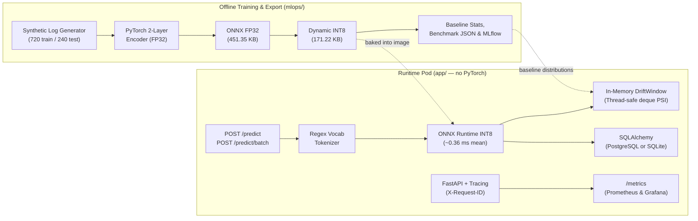

# Cloud-Native AI Inference & MLOps Platform

Low-latency log anomaly classification service built to separate heavy model training from slim production serving. A 2-layer PyTorch encoder (`LightweightLogTransformer`) is trained, exported to ONNX, dynamically quantized to INT8, and served behind FastAPI with PostgreSQL/SQLite persistence, in-memory PSI drift monitoring, Prometheus/Grafana telemetry, Kubernetes HPA manifests, and Terraform IaC.

## Architecture



## Engineering Choices & Trade-offs

- **No PyTorch in the serving container**: `requirements-mlops.txt` is isolated to training/export; the multi-stage `Dockerfile` (`python:3.11-slim`, non-root `appuser` UID `10001`) installs only `requirements-serve.txt` (`onnxruntime`, FastAPI, SQLAlchemy, Prometheus client).
- **Verified INT8 quantization**: `mlops/train_export.py` compares PyTorch FP32, ONNX FP32, and ONNX INT8 outputs on the held-out split before writing artifacts, recording logit divergence (`int8_max_abs_diff = 0.241`) alongside latency gains (`2.34x` speedup).
- **Hot-path drift detection without per-request DB scans**: on startup, `DriftWindow` (`collections.deque(maxlen=DRIFT_WINDOW_SIZE)`) is seeded once from the most recent persisted rows. Live requests append `(length, incident_probability, label)` in memory under a lock; `compute_psi` clamps outer histogram edges to `-inf`/`+inf` so extreme out-of-distribution inputs are still captured without returning `NaN`.
- **Zero-config local runs, Postgres in deployment**: `DATABASE_URL` defaults to local SQLite for fast local/CI execution and switches to `postgresql+psycopg` via environment config in Docker Compose or Cloud Run.

## Benchmarks

Measured on CPU (`Python 3.11.2`, `torch 2.5.1+cpu`, `onnxruntime 1.20.1`, `mlflow 2.19.0`) over 240 held-out test records (`vocab_size = 419`; full output in `artifacts/benchmark_report.json`):

| Runtime | Artifact Size | Mean Latency | P95 Latency | Held-out F1 |
|---|---|---|---|---|
| PyTorch FP32 | — | 0.846 ms | 1.087 ms | 1.00 |
| ONNX FP32 | 451.35 KB | 0.429 ms | 0.513 ms | 1.00 |
| ONNX INT8 | 171.22 KB (`2.64x` smaller) | 0.361 ms (`2.34x` faster) | 0.448 ms | 1.00 |

## API Contract

| Method | Path | Behavior |
|---|---|---|
| `GET` | `/health` | Liveness check returning status and active `model_version` |
| `GET` | `/ready` | Readiness check verifying ONNX session initialization and DB ping |
| `POST` | `/predict` | Classifies a single log line (`NORMAL` / `INCIDENT`), logs to DB, updates PSI |
| `POST` | `/predict/batch` | Batch classification (up to 64 items) with bulk DB insert |
| `GET` | `/drift` | Returns current window size, `input_length_psi`, `prediction_prob_psi`, and alert flag |
| `GET` | `/history?limit=20` | Lists recent persisted predictions (`limit` 1..200) |
| `GET` | `/metrics` | Prometheus exposition (`mlops_inference_requests_total`, latency, confidence, PSI gauges, `mlops_drift_alert_active`) |

Example inference request:

```bash
curl -s -X POST http://127.0.0.1:8000/predict \
  -H "Content-Type: application/json" \
  -d '{"text":"CRITICAL service=worker-pool region=eu-central-1 out of memory oom killer"}'
```

Response shape:

```json
{
  "id": 1,
  "label": "INCIDENT",
  "confidence": 0.9994,
  "incident_probability": 0.9994,
  "normal_probability": 0.0006,
  "latency_ms": 0.41,
  "token_count": 11,
  "model_version": "transformer-onnx-int8-v1",
  "storage_backend": "sqlite"
}
```

## Project Layout

```text
app/                  FastAPI app, ONNX runtime engine, SQLAlchemy store, PSI drift, metrics
mlops/                Synthetic log corpus, Transformer definition, ONNX/INT8 export, MLflow logging
artifacts/            Exported FP32/INT8 ONNX models, tokenizer vocab, baseline stats, benchmarks
monitoring/           Prometheus scrape config and auto-provisioned Grafana dashboard
k8s/                  Namespace, Deployment, Service, and CPU-based HPA (2-5 replicas, 70% target)
infra/terraform/      Google Cloud Run + Artifact Registry Terraform configuration
tests/                API, ONNX inference, PSI drift, and training pipeline test suites
scripts/              End-to-end smoke demo client
```

## Configuration

Settings load from environment variables or `.env` (see `.env.example`):

| Variable | Default | Purpose |
|---|---|---|
| `DATABASE_URL` | `sqlite:///./data/predictions.db` | SQLAlchemy connection URI (`postgresql+psycopg://...` in prod) |
| `MODEL_PATH` | `artifacts/model_int8.onnx` | Path to ONNX model loaded by `onnxruntime` |
| `DRIFT_WINDOW_SIZE` | `100` | Sliding window capacity (`10..10000`) for rolling PSI |
| `DRIFT_PSI_THRESHOLD` | `0.25` | PSI threshold that trips `DRIFT_DETECTED` and `mlops_drift_alert_active` |
| `MAX_SEQ_LEN` | `48` | Fixed token sequence length expected by the ONNX graph |

## Running Locally & CI

Train/export the quantized model and run unit/API tests (enforces >=85% coverage):

```bash
pip install -r requirements-mlops.txt
python -m mlops.train_export --epochs 8
pytest -v --cov=app --cov=mlops --cov-fail-under=85
```

Bring up the full local stack (API `:8000`, Postgres `:5432`, Prometheus `:9090`, Grafana `:3001`):

```bash
docker compose up --build
```

Validate Terraform configuration:

```bash
cd infra/terraform && terraform fmt -check && terraform init -backend=false && terraform validate
```

On every push/PR to `main`, `.github/workflows/ci.yml` runs `ruff check`, full ONNX export + `pytest`, Terraform checks, Docker image build, deployment onto an ephemeral `kind` Kubernetes cluster (`k8s/` manifests + live `curl` smoke probes), and pushes the container image to GHCR on `main`.

## Limitations

- The model is trained on synthetic log templates (`mlops/dataset.py`); `1.00` accuracy/F1 reflects clean separation on that synthetic split rather than noisy production telemetry.
- `DriftWindow` is process-local memory per pod (seeded once at startup from the latest `DRIFT_WINDOW_SIZE` DB rows). With `HPA` scaling (`2..5` replicas), each pod tracks drift over requests routed to its own window rather than computing a cluster-wide aggregate.
- `scripts/smoke_demo.py` expects an already running service at `--base-url`.
