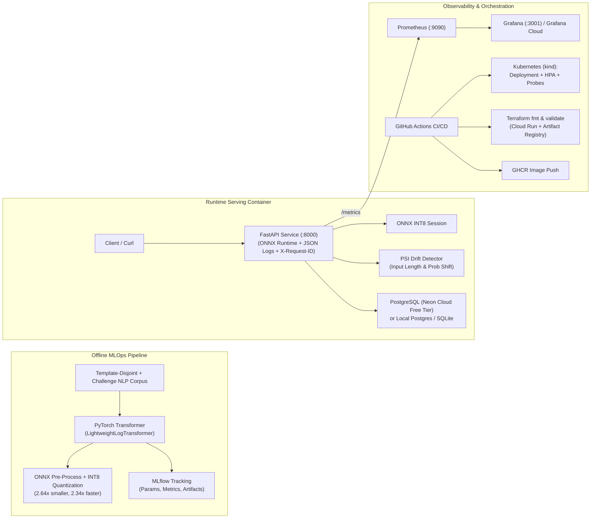

# Cloud-Native AI Inference & MLOps Platform

[](https://github.com/Bisher-eng-1/cloud-native-ai-mlops-platform/actions/workflows/ci.yml)


An end-to-end, `$0` cloud-native MLOps platform that trains and evaluates a lightweight PyTorch NLP Transformer, optimizes it via **ONNX pre-processing and dynamic INT8 quantization**, tracks experiments and confusion matrices in **MLflow**, serves low-latency predictions via a lean **FastAPI + ONNX Runtime** container (without PyTorch bloat in runtime), emits **structured JSON request logs with `X-Request-ID` tracing**, persists telemetry to **Cloud PostgreSQL (Neon Free Tier)** or local Postgres, detects **input and prediction drift (PSI)**, exposes **Prometheus + Grafana** observability, and verifies **Kubernetes (`kind`)** and **Terraform IaC** in GitHub Actions.

---

## Table of Contents

1. [Architecture & Data Flow](#architecture--data-flow)
2. [Measured Model Optimization & Benchmark Results](#measured-model-optimization--benchmark-results)
3. [Engineering Highlights & Architecture Decisions](#engineering-highlights--architecture-decisions)
4. [HTTP API Reference](#http-api-reference)
5. [Quick Start (Local, Docker Compose, and $0 Cloud)](#quick-start-local-docker-compose-and-0-cloud)
6. [Automated Verification, Kubernetes (`kind`), & CI/CD](#automated-verification-kubernetes-kind--cicd)
7. [Repository Structure](#repository-structure)
8. [Scope & Explicit Limitations](#scope--explicit-limitations)

---

## Architecture & Data Flow



---

## Measured Model Optimization & Benchmark Results

Measured locally by running `python -m mlops.train_export --epochs 10` (`Python 3.11.2`, `torch 2.5.1+cpu`, `onnxruntime 1.20.1`, `mlflow 2.19.0`) on the deterministic template-disjoint dataset including hard boundary challenge cases (`720` training records, `240` held-out test records: `120` normal / `120` incident, `120` single-record latency benchmark runs after `10` warmup runs):

| Variant | Accuracy / F1 | Confusion Matrix (`TP / TN / FP / FN`) | Model Size (KB) | Mean Latency (ms) | p95 Latency (ms) | Notes |
| :--- | :---: | :---: | :---: | :---: | :---: | :--- |
| **PyTorch FP32** | `1.0000` / `1.0000` | `120 / 120 / 0 / 0` | `—` | `0.8461 ms` | `1.0874 ms` | Training & baseline runtime |
| **ONNX Runtime FP32** | `1.0000` / `1.0000` | `120 / 120 / 0 / 0` | `451.35 KB` | `0.4290 ms` | `0.5126 ms` | `max_abs_diff = 1.7e-6` vs PyTorch |
| **ONNX Runtime INT8** | `1.0000` / `1.0000` | `120 / 120 / 0 / 0` | `171.22 KB` | `0.3612 ms` | `0.4476 ms` | **`2.64x` smaller · `2.34x` faster vs PyTorch** |

> **Dataset honesty note:** These evaluation numbers reflect the bundled synthetic, template-disjoint operational log corpus plus boundary challenge templates (`mlops/dataset.py`). They validate pipeline correctness, ONNX parity, and INT8 latency speedup; they are not real-world production telemetry guarantees.

---

## Engineering Highlights & Architecture Decisions

Detailed trade-offs are documented in [`docs/ARCHITECTURE_DECISIONS.md`](./docs/ARCHITECTURE_DECISIONS.md):

- **Strict Training vs. Serving Dependency Split:** PyTorch + MLflow live exclusively in `requirements-mlops.txt`, while the runtime `Dockerfile` installs only `requirements-serve.txt` (`onnxruntime`, `fastapi`, `sqlalchemy`, `prometheus-client`) — keeping containers small and memory-friendly on `8 GB RAM` machines.
- **Structured JSON Telemetry & Request Correlation:** Every HTTP call passes through `request_tracing_middleware` (`app/main.py`, `app/logging_utils.py`), injecting `X-Request-ID` headers and emitting single-line JSON logs with `duration_ms` and `status_code`.
- **Statistical Drift Monitoring (PSI):** Compares live sliding windows (`DRIFT_WINDOW_SIZE`) against `artifacts/baseline_stats.json` across both input text lengths and model incident probabilities, triggering `mlops_drift_alert_active` in Prometheus when PSI >= `0.25`.
- **Zero-Friction Cloud Database Compatibility:** `app/db.py` automatically normalizes `postgres://` and `postgresql://` connection strings (e.g., **Neon Free Tier**) to `postgresql+psycopg://`, with SQLite fallback for isolated tests.
- **Modern Python Tooling:** Configured via [`pyproject.toml`](./pyproject.toml) with **Ruff** (`E`, `F`, `I`, `UP`, `B`, `SIM`) and **Pytest** coverage enforcement.

---

## HTTP API Reference

| Method | Path | Purpose |
| :--- | :--- | :--- |
| `GET` | `/` | Service metadata and available endpoints index |
| `GET` | `/health` | Liveness probe returning service health and model version |
| `GET` | `/ready` | Readiness probe executing `SELECT 1` against PostgreSQL/SQLite |
| `POST` | `/predict` | Classify one operational log/event (`{"text": "..."}`) and persist telemetry |
| `POST` | `/predict/batch` | Classify up to `64` texts in a single ONNX batch forward pass |
| `GET` | `/drift` | Compute current PSI drift status, mean text length, and incident rate vs baseline |
| `GET` | `/history?limit=20` | Inspect recent persisted predictions from PostgreSQL/SQLite |
| `GET` | `/metrics` | Prometheus exposition endpoint (request counts, latency histogram, confidence, PSI) |

---

## Quick Start (Local, Docker Compose, and `$0` Cloud)

### Option A: Fast Local Run (Zero Docker / Zero Cloud Setup)

```bash
python -m venv .venv
# Windows PowerShell: .venv\Scripts\Activate.ps1
# Linux / macOS:      source .venv/bin/activate

pip install -r requirements-serve.txt
uvicorn app.main:app --host 127.0.0.1 --port 8000
```

In another terminal, test live inference and drift endpoints:

```bash
python scripts/smoke_demo.py
```

### Option B: Full Observability Stack (`Docker Compose`)

Starts **FastAPI + PostgreSQL 16 + Prometheus + Grafana** (`mlops-overview` dashboard pre-provisioned):

```bash
docker compose up --build -d
```

- **FastAPI Docs:** `http://127.0.0.1:8000/docs`
- **Prometheus:** `http://127.0.0.1:9090`
- **Grafana:** `http://127.0.0.1:3001` (`admin` / `admin_dev_password`)

### Option C: Connect `$0` Neon Cloud PostgreSQL & Grafana Cloud

See [`docs/CLOUD_SETUP.md`](./docs/CLOUD_SETUP.md) for copy-paste steps to connect **Neon Free PostgreSQL**, **Grafana Cloud Free Tier**, and `.wslconfig` memory tuning for `8 GB RAM` Windows 10 laptops.

### Re-Run PyTorch Training, ONNX Quantization & MLflow Tracking

```bash
pip install torch==2.5.1 --index-url https://download.pytorch.org/whl/cpu
pip install -r requirements-mlops.txt
ruff check .
python -m mlops.train_export --epochs 10
```

---

## Automated Verification, Kubernetes (`kind`), & CI/CD

Run linting and unit/API tests with coverage locally:

```bash
ruff check .
pytest -v --cov=app --cov=mlops --cov-report=term-missing tests/
```

### GitHub Actions Workflow (`.github/workflows/ci.yml`)

Every push / pull request runs three jobs:
1. **`mlops-test-and-onnx`:** Runs `ruff check .`, executes `mlops.train_export`, and runs `pytest` with an enforced `>=85%` coverage gate (`96%` currently).
2. **`terraform-validate`:** Checks `terraform fmt -check` and `terraform validate` across `infra/terraform/`.
3. **`docker-and-kind-k8s`:** Builds the lean multi-stage, non-root Docker image, spins up a real **`kind`** Kubernetes cluster, loads the local image, applies `k8s/` (`Namespace`, `Deployment`, `Service`, `HPA`), waits for rollout, smoke-tests `/health`, `/ready`, `/predict`, and `/metrics` over `kubectl port-forward`, and pushes `:latest` to `ghcr.io` on `main`.

---

## Repository Structure

```text
cloud-native-ai-mlops-platform/
├── .github/workflows/ci.yml          # Ruff + Pytest + ONNX + Terraform + kind K8s + GHCR
├── pyproject.toml                    # Ruff & Pytest configuration
├── app/
│   ├── config.py                     # Pydantic settings (.env + Neon URL support)
│   ├── db.py                         # SQLAlchemy models & Neon/Postgres/SQLite manager
│   ├── drift.py                      # Population Stability Index (PSI) drift detector
│   ├── inference.py                  # ONNX Runtime CPU session + softmax probabilities
│   ├── logging_utils.py              # Structured JSON log formatter
│   ├── main.py                       # FastAPI endpoints, tracing middleware & lifespan
│   ├── metrics.py                    # Prometheus counters, histograms, and drift gauges
│   └── tokenizer.py                  # Deterministic JSON-backed tokenizer
├── mlops/
│   ├── dataset.py                    # Template-disjoint + challenge NLP dataset
│   ├── model.py                      # PyTorch Transformer Encoder classifier
│   └── train_export.py               # Train -> ONNX pre-process -> INT8 -> Benchmark -> MLflow
├── artifacts/                        # Pre-exported INT8/FP32 ONNX, tokenizer & stats
├── k8s/                              # Namespace, Deployment, Service, HPA manifests
├── infra/terraform/                  # Cloud Run v2 + Artifact Registry Terraform IaC
├── monitoring/                       # Prometheus config + Grafana provisioned dashboard
├── scripts/smoke_demo.py             # Live endpoint verification script
├── tests/                            # Pytest unit & integration tests
├── Dockerfile                        # Lean non-root serving image (no PyTorch bloat)
├── docker-compose.yml                # API + Postgres + Prometheus + Grafana stack
├── requirements-serve.txt            # Minimal runtime dependencies
├── requirements-mlops.txt            # Training, ONNX, MLflow, Ruff, and test dependencies
└── docs/
    ├── ARCHITECTURE_DECISIONS.md     # Engineering ADRs & design trade-offs
    └── CLOUD_SETUP.md                # $0 Neon + Grafana Cloud + 8GB WSL2 guide
```

---

## Scope & Explicit Limitations

- **Synthetic Training Corpus:** The bundled model is trained on deterministic template-disjoint synthetic logs (plus boundary challenge templates) for reproducible GPU-free execution. Production deployment requires labelled domain telemetry.
- **Local Kubernetes Verification:** Kubernetes manifests and HPA behavior are executed against an ephemeral **`kind`** cluster in CI rather than a paid managed cloud cluster (EKS/GKE).
- **Terraform Cloud Deployment Path:** `infra/terraform/` defines a serverless Google Cloud Run v2 + Artifact Registry deployment path verified via `terraform fmt` and `terraform validate` in CI; live `terraform apply` requires a cloud project and billing setup.
- **Stateless Per-Record Inference:** Events are classified independently without multi-line stack-trace correlation across requests.
